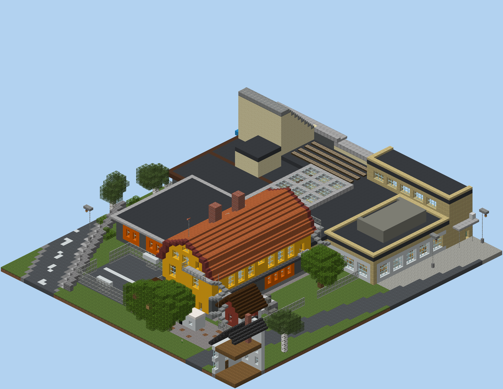

# Sturköskolan i Minecraft

A Minecraft **Java 1.21.11** world of Sturköskolan (the yellow school + the connected modern
buildings), built from the photos in `_input/`, the Google aerial and OpenStreetMap footprints.
Scale: 1 m ≈ 1.2 blocks.



* Installed in PrismLauncher → instance **1.21.11** → world **Sturköskolan**.
* Portable copy: `Sturkoskolan.zip` (unzip into any `.minecraft/saves/`).
* Creative mode, peaceful, cheats on. You spawn on the parking lot looking at the school.

## Things to find
* The yellow school: classrooms with desks and blackboards on two floors, stairs up to an
  attic library/art room, spiral fire escapes and gable balconies.
* Entrance under the blue canopy into the tall "wedge" hall, library with the round porthole
  windows, preschool with nap beds, dining hall under a glass roof, kitchen, woodwork room
  (crafting tables), fritidsgård with ping-pong + jukebox, gym with wall bars, ropes and goals.
* Playground: play tower with a slide, swings, sandbox and an in-ground **trampoline made of
  slime blocks** (it really bounces).
* Sturkö Kvarn (the windmill, climb the ladder + walk the gallery), the pizzeria, the bus stop
  "Kvarnen", the ball court, the big boulder, the caravan and container.

## Rebuilding
```
nix-shell                                   # python (pillow, numpy, nbtlib) + java 21
MC_ASSETS=<extracted client jar> python3 generator/build.py --render   # preview images → renders/
python3 generator/deploy.py <server dir> --install <saves dir>          # real build via a 1.21.11 server
```
`generator/yellow.py` is the old building, `modern.py` the newer wings, `surroundings.py` the rest.
